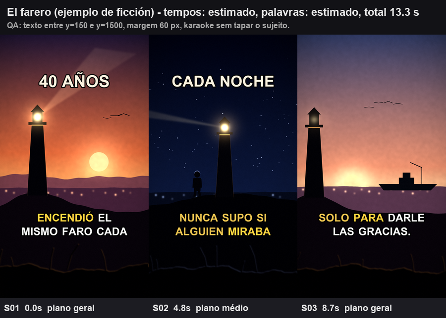

# Silueta Studio

[](https://github.com/silueta-studio/silueta-studio/actions/workflows/testes.yml)

**Vertical story videos — 2D silhouettes, rim light, parallax and karaoke captions — drawn in pure Python and directed by Claude Code.**

[English](#english) · [Español](#español)

<p align="center"></p>

---

## English

`silueta` turns a shot-by-shot script into a finished 1080×1920 video: original silhouettes drawn in code (no stock images),
3–5 parallax layers, rim light, film grain, spring-in title cards, word-by-word karaoke synced to your real voice-over,
and automatic quality gates. It is the engine behind a faceless "true stories" channel, packaged so that
[Claude Code](https://claude.com/claude-code) can research, write, draw, render and check a video with you.

### What you get
- **A Python engine** (numpy + Pillow + SciPy + ffmpeg): camera push/parallax, terrain ridges, skies, sun/moon, light rays,
  embers, people, birds, ships, sprite compositing, transitions (dissolve, fade-to-black, white flash, whip pan).
- **Karaoke captions** in the safe zone, with the active word popping in yellow; long words shrink to fit.
- **Forced alignment** with WhisperX: real timings per shot and per word, numbers mapped back to your script ("6" ↔ "seis").
- **Audio mix**: voice levelling, your music ~20 dB under the voice (+5 dB in pauses), SFX ducking, −14 LUFS loudness.
- **Parallel, resumable render** to H.264 High (CRF 17, GOP 60) plus a ≤ 30 MB review copy.
- **QA gates**: seedless randomness, missing glyphs, reading speed, dead air, too-short shots, flashes (> 3/s fails), loudness/true peak.
- **Claude Code setup**: `CLAUDE.md` with the craft rules, and 4 agents — `researcher`, `scriptwriter`, `scene-designer`, `render-qa`.

### Install (≈ 10 min)
Needs Python ≥ 3.10 and [ffmpeg](https://ffmpeg.org/download.html) on your PATH.
```
git clone https://github.com/silueta-studio/silueta-studio && cd silueta-studio
python -m venv .venv
.venv/Scripts/activate          # Linux/macOS: source .venv/bin/activate
pip install .
silueta -h
```
Optional, for real voice timings: install [WhisperX](https://github.com/m-bain/whisperX) in its own venv (it brings PyTorch, ~3 GB)
and pass its Python with `--python`.

### Make a video
```
silueta new my_story       # copies the example (historia.json + cenas.py)
silueta sheet my_story     # contact sheet (1 frame per shot) + safe-zone QA -> my_story/prova.png
# record one voice file per shot: my_story/voz/s01.mp3, s02.mp3, ...
silueta align my_story --python <whisperx-venv>/Scripts/python
silueta mix my_story       # voice + your licensed music/SFX declared in historia.json
silueta render my_story    # -> final.mp4 + final_revisao.mp4
silueta qa my_story
```
If Windows blocks `silueta.exe`, run the same commands as `python -m silueta_studio <command>`.
Without a voice yet, `render --force` uses estimated timings (for tests only).
With Claude Code, just open the folder and ask: *"make a 90-second video about <story>"* — the agents follow `CLAUDE.md`.

<p align="center"></p>

### Rules the kit enforces
Two independent sources per fact · no photos, logos or third-party characters · music and SFX only from files **you** own a licence for
(none are bundled) · nothing is published or paid for without your explicit OK.

### Speed
About 0.85 s per frame on one core; the parallel render uses physical cores − 1 (7 processes: ~0.28 s/frame, so a 2-minute video ≈ 15 min).

### Licence
MIT — see `LICENSE`. Third-party code and ideas: `THIRD_PARTY.md`.

---

## Español

`silueta` convierte un guion por planos en un vídeo vertical terminado (1080×1920): siluetas originales dibujadas en código
(sin bancos de imágenes), 3–5 capas con paralaje, luz de recorte, grano, carteles con rebote, subtítulos karaoke palabra a palabra
sincronizados con tu voz real y controles de calidad automáticos. Es el motor de un canal de "historias reales que parecen inventadas",
empaquetado para que [Claude Code](https://claude.com/claude-code) investigue, escriba, dibuje, renderice y revise un vídeo contigo.

### Qué incluye
- **Motor en Python** (numpy + Pillow + SciPy + ffmpeg): cámara con paralaje, crestas de terreno, cielos, sol/luna, rayos de luz,
  brasas, personas, aves, barcos, sprites y transiciones (fundido, negro, destello blanco, barrido).
- **Karaoke** dentro de la zona segura, con la palabra activa en amarillo; las palabras largas se encogen para caber.
- **Alineación forzada** con WhisperX: tiempos reales por plano y por palabra; los números vuelven al guion ("6" ↔ "seis").
- **Mezcla**: voz nivelada, tu música ~20 dB bajo la voz (+5 dB en las pausas), efectos con ducking, −14 LUFS.
- **Render en paralelo y reanudable** a H.264 High (CRF 17, GOP 60) y una copia de revisión de ≤ 30 MB.
- **Controles de calidad**: aleatoriedad sin semilla, glifos que faltan, velocidad de lectura, huecos muertos, planos demasiado cortos,
  destellos (> 3/s falla), sonoridad y pico real.
- **Claude Code**: `CLAUDE.md` con las reglas del oficio y 4 agentes — `researcher`, `scriptwriter`, `scene-designer`, `render-qa`.

### Instalación (≈ 10 min)
Python ≥ 3.10 y [ffmpeg](https://ffmpeg.org/download.html) en el PATH; los comandos son los de arriba.
Opcional: [WhisperX](https://github.com/m-bain/whisperX) en su propio venv para los tiempos reales de la voz (`--python`).

### Hacer un vídeo
`new` → `sheet` → grabar `voz/s01.mp3…` → `align` → `mix` → `render` → `qa` (ver arriba).
Con Claude Code: abre la carpeta y pide *"haz un vídeo de 90 segundos sobre <historia>"*.

### Reglas
Dos fuentes independientes por dato · nada de fotos, logos ni personajes ajenos · música y efectos solo con licencia tuya
(el kit no trae ninguno) · nada se publica ni se paga sin tu permiso explícito.

### Licencia
MIT — ver `LICENSE`. Código e ideas de terceros: `THIRD_PARTY.md`.
